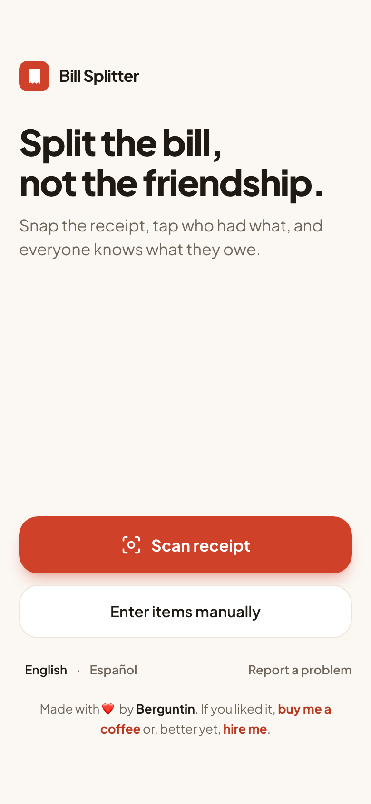
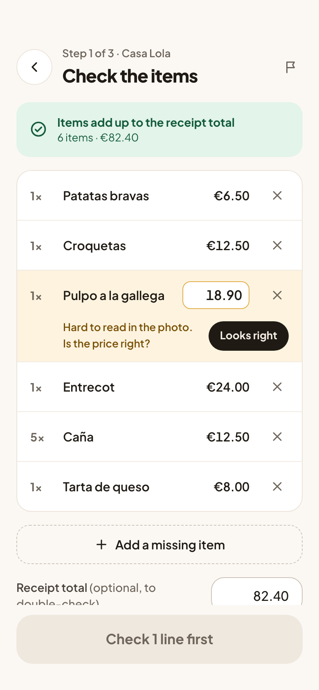
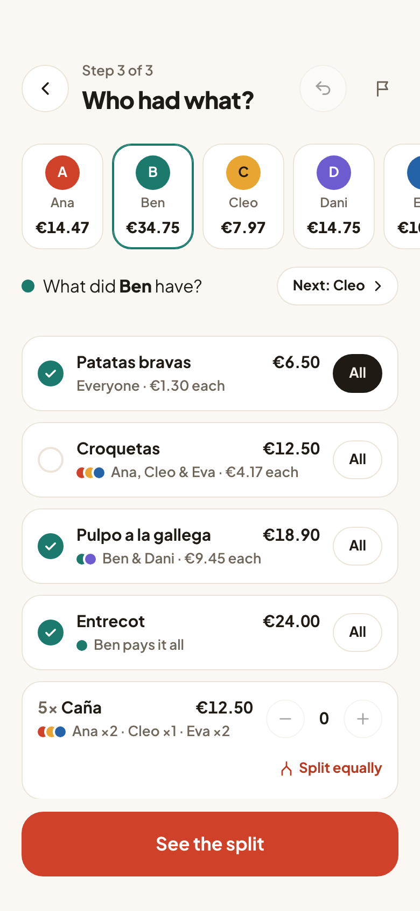
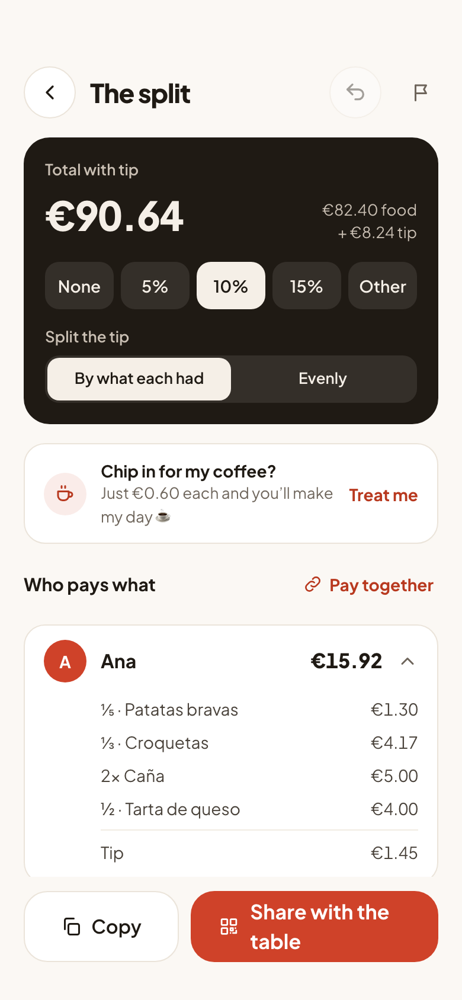
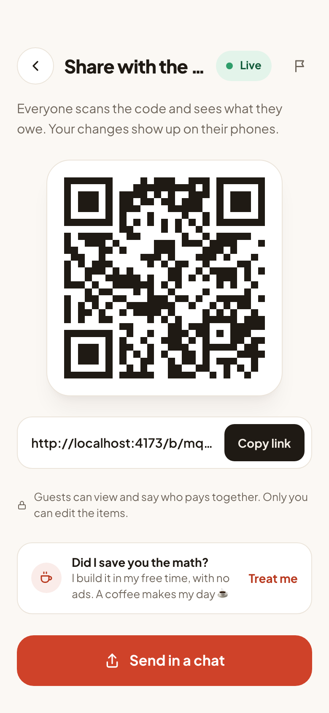
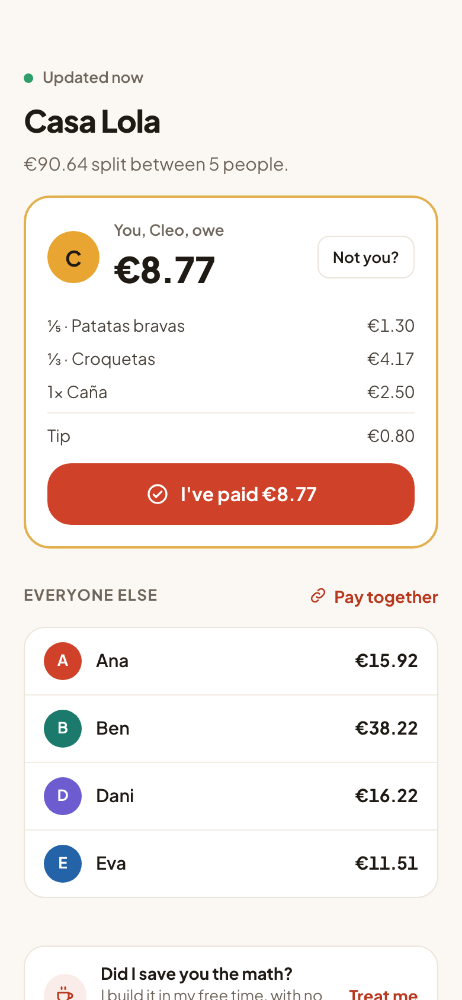
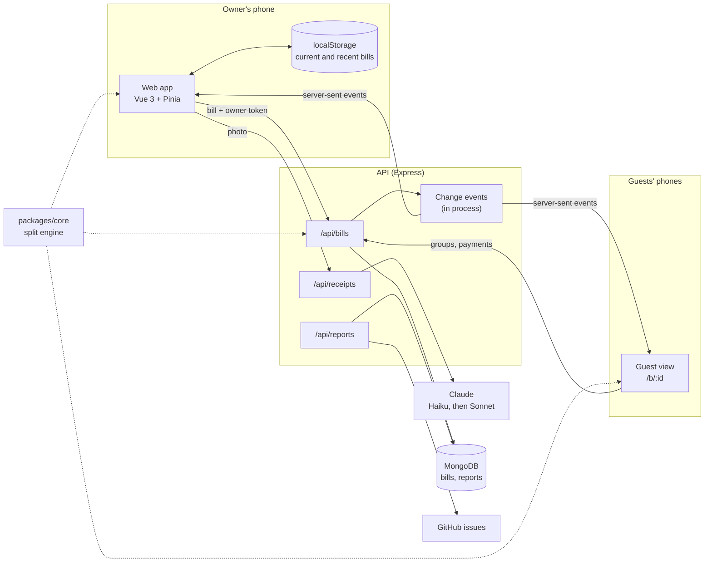

# Bill Splitter

Scan a restaurant receipt, tap who had what, and see exactly what each person owes.

Receipts can be scanned or entered by hand, split, and shared with the table
through a QR code. See the [roadmap](docs/ROADMAP.md) and the
[API reference](docs/API.md).

| Home                                                  | Check the items                                          | Who had what                                                         |
| ----------------------------------------------------- | -------------------------------------------------------- | -------------------------------------------------------------------- |
|              |   |  |
| **The split**                                         | **Share with the table**                                 | **Guest view**                                                       |
|  |  |       |

## Features

- **Receipt scanning**: take a photo and get every line item and its price.
  Lines that were hard to read are highlighted for a person to check.
- **One person at a time**: pick a diner, tap what they had, move on to the
  next. An item can belong to one diner, be shared by a few, be split among
  everyone, or be counted unit by unit ("5× Beer").
- **Undo**: every change on the assignment and summary screens can be undone.
- **Tips and discounts**: split proportionally to consumption or evenly.
- **Cent-perfect totals**: every split adds up to the receipt total, always.
- **Share via QR**: everyone at the table follows the split from their phone,
  with no account and nothing to install.
- **Pay together**: group a couple or friends so they settle up as one.
- **Mark as paid**: guests mark their share as paid, and the owner sees it live.
- **Live updates**: shared bills update on every phone within a second.
- **Recent bills**: the last 20 bills split on the device can be reopened.
- **English and Spanish**: picked from the browser's languages, switchable on
  the home screen.
- **Report a problem**: from any screen, with optional context attached.

## Architecture



```
apps/
  web/        Vue 3 + Vite + TypeScript + Tailwind CSS front end
  api/        Node + Express API (receipt parsing, shared bills, bug reports)
packages/
  core/       Framework-agnostic domain model and split engine
```

**`packages/core`** holds the domain model (bills, diners, items, assignments,
adjustments, groups, payments) and every money calculation: allocation,
breakdowns, receipt checks and anonymization. It has no framework or I/O
dependencies, and both the web app and the API import it, so they always agree
on the numbers. The API, for example, recomputes what each diner owes when they
mark a payment instead of trusting the client.

**`apps/web`** is a local-first single-page app. The bill being split lives in a
Pinia store (`stores/bill.ts`) that is saved to `localStorage` on every change
and keeps an undo history, so the whole flow (enter or scan items, add diners,
assign, see the split) works offline and survives a reload. Each screen is a
view under `src/views`, and the views only orchestrate `core`. Recent bills are
kept on the device (`stores/history.ts`) and never sent anywhere.

**Sharing** is opt-in. When the owner shares a bill, `stores/share.ts` creates it
on the API (`POST /api/bills`), keeps the returned owner token on the device,
and pushes later edits with it (`PUT /api/bills/:id`). Guests open `/b/:id`,
which follows the bill through server-sent events with ETag polling as a
fallback (`composables/useSharedBill.ts`). Guests can't edit items or prices:
they can only say who pays together and mark their share as paid, through
narrow endpoints that apply the change on the latest version of the bill and
retry on conflicts.

**`apps/api`** is an Express app wired in `app.ts`:

- `routes/receipts.ts` sends the photo to Claude and validates the structured
  result (see [How receipts are read](#how-receipts-are-read)). Photos are
  never stored.
- `routes/bills.ts` stores shared bills in MongoDB, or in memory during
  development, and they expire 7 days after their last change.
  `bills/events.ts` notifies open pages of every change. The events live in
  process, so running several API instances would need a shared channel such
  as MongoDB change streams. Until then, clients still catch up through
  polling.
- `routes/reports.ts` stores bug reports for 90 days and opens or updates a
  GitHub issue for each kind of failure.
- `observability/` adds request ids, JSON logs and Sentry (see
  [Monitoring](#monitoring)).

## Getting started

Requirements: Node.js 22.12 or later and pnpm 10 (`corepack enable` installs the
version pinned in `package.json`).

```bash
pnpm install
pnpm dev          # web on http://localhost:5173, API on http://localhost:3000
```

Without configuration the API uses a fake receipt reader that always returns
the same sample receipt, so the whole app works offline. To read real receipts,
copy `apps/api/.env.example` to `apps/api/.env` and set `ANTHROPIC_API_KEY`.
Shared bills are kept in memory unless `MONGODB_URI` points to a MongoDB
database (required in production).

| Command                                     | What it does                               |
| ------------------------------------------- | ------------------------------------------ |
| `pnpm dev`                                  | Runs the web app and the API in watch mode |
| `pnpm test`                                 | Runs every package's unit tests            |
| `pnpm --filter @bill-splitter/web test:e2e` | Runs the browser tests (Playwright)        |
| `pnpm typecheck`                            | Type-checks every package                  |
| `pnpm lint`                                 | Lints the whole repository                 |
| `pnpm format`                               | Formats the whole repository with Prettier |
| `pnpm check`                                | Everything CI runs, except the build       |
| `pnpm build`                                | Builds the web app and the API             |

## Deploying on Railway

Create two services from this repository, both with an empty Root Directory
(the workspace needs the whole repo):

| Service | Variables                                                                                                                      |
| ------- | ------------------------------------------------------------------------------------------------------------------------------ |
| web     | `SERVICE=web`, `VITE_API_URL=https://<api domain>`                                                                             |
| api     | `SERVICE=api`, `NODE_ENV=production`, `ANTHROPIC_API_KEY`, `MONGODB_URI`, `CORS_ORIGINS=https://<web domain>`, `TRUST_PROXY=1` |

Optional, for error monitoring with Sentry (see [Monitoring](#monitoring)):

| Service | Variables                                                                                        |
| ------- | ------------------------------------------------------------------------------------------------ |
| web     | `VITE_SENTRY_DSN`, and to upload source maps `SENTRY_AUTH_TOKEN`, `SENTRY_ORG`, `SENTRY_PROJECT` |
| api     | `SENTRY_DSN`                                                                                     |

To show the "support the app" link (home footer, summary, share screen and
guest view), set `VITE_KOFI_URL=https://ko-fi.com/<your page>` on the web
service. Without it, the link is hidden.

Railway runs the root `build` and `start` scripts; `SERVICE` picks which app is
built (without type checking, which CI runs) and started. Don't set custom
build or start commands in the dashboard: they would bypass that. In each
service's settings, set the health check path (`/` for web, `/api/health` for
api) and, if available, watch paths (`/apps/web/**` or `/apps/api/**`, plus
`/packages/core/**`, `/pnpm-lock.yaml`, `/package.json` and `/scripts/**`), so a
change to one app does not redeploy the other. `VITE_*` variables are read at
build time, so redeploy the web service after changing them.

## Monitoring

- **Logs.** The API writes one JSON line per request (id, method, path, status,
  latency) plus events such as `receipt scanned` (models tried, issues found,
  tokens used, timings) and `bill shared`. Bill contents, names, images, IP
  addresses and tokens are never logged. Filter by `req.id` in the host's log
  viewer to follow one request. Set `LOG_LEVEL=debug` to also log bill updates.
- **Request ids.** The web app sends an `X-Request-Id` with each call and shows
  it next to errors (`Ref. 7F3K-92QD`), so a report can be traced to its logs.
- **Errors.** With a Sentry DSN set, unexpected errors in the web app and the
  API are reported to Sentry (EU region), tagged with the release (the git
  commit, from `RAILWAY_GIT_COMMIT_SHA`), the screen or route and the request
  id. The web app keeps a masked session replay only for sessions with an
  error. Request bodies, headers, cookies, local variables and AI inputs are
  never sent. Source maps are uploaded at build time when `SENTRY_AUTH_TOKEN`
  is set, and deleted from the build so they are not public. The SDK loads
  after the first screen, so it does not slow the app down.
- **Bug reports.** Every screen has a "Report a problem" button (the flag), and
  error messages offer "Report this problem" with their reference. The report
  carries the user's description, an optional email, and on request the
  current bill (names replaced) and the receipt photo or a screenshot. The app
  adds its version, device, screens visited, recent errors and API calls with
  their request ids, the last scan and the Sentry event id. Reports are stored
  in MongoDB for 90 days and, with `GITHUB_TOKEN`, open a GitHub issue labelled
  `bug-report`; reports of the same failure are added to the open issue as
  comments.
- **Health.** `GET /api/health` returns 503 when MongoDB is unreachable. Point
  an uptime monitor (for example UptimeRobot or Better Stack, both free) at it
  to get an alert when the API goes down.

## How receipts are read

The web app downscales the photo to 1600 px and sends it to
`POST /api/receipts/parse`. The API asks Claude Haiku 5.5 to transcribe the
receipt into a fixed JSON shape (structured outputs), with amounts copied as
printed and parsed into cents on our side. If the lines do not add up to the
printed total, some lines are uncertain, or the model declines, the API retries
with Claude Sonnet 5.5 and keeps the more trustworthy result. Uncertain lines
are highlighted for a person to check. Photos are never stored.

`pnpm --filter @bill-splitter/api eval:receipts` measures accuracy on a private
set of real receipts (see `apps/api/eval/README.md`).

## How the split works

Amounts are stored as integer cents. Whenever an amount has to be divided, the
engine uses the largest remainder method: 10.00 split three ways becomes
3.34 + 3.33 + 3.33, never 3.33 × 3. Items whose diner was removed, and items
nobody has claimed yet, are reported as _unassigned_ instead of being lost, so
the diners' totals plus the unassigned total always equal the bill total.
